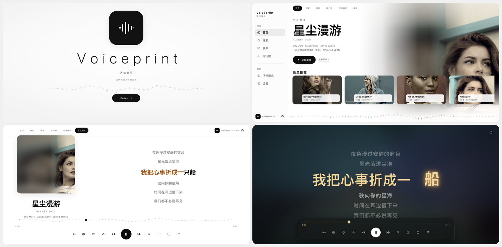
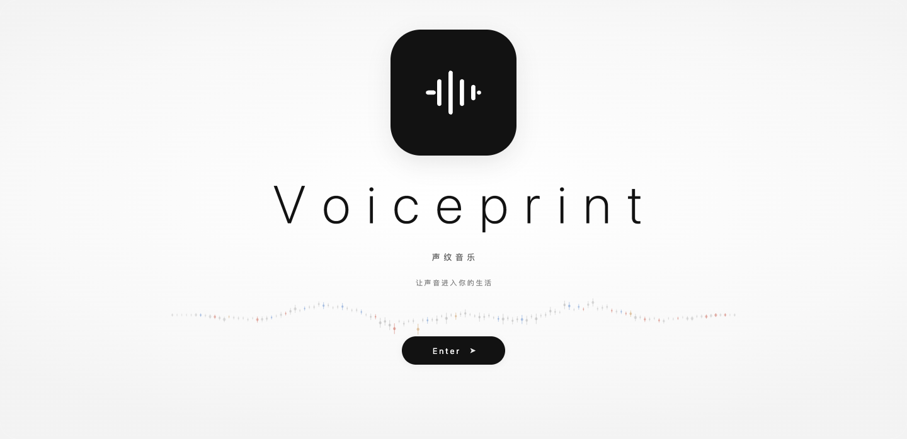
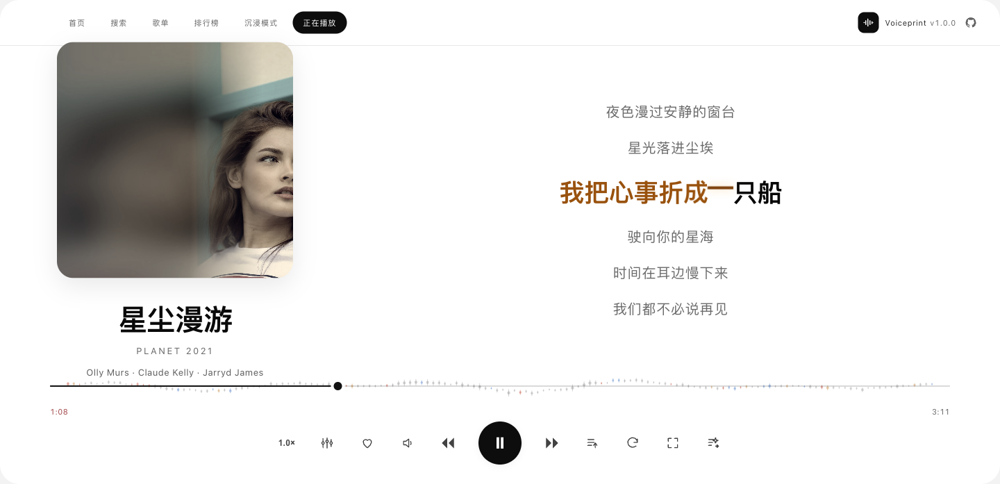

  

<h1 align="center">Voiceprint 声纹音乐</h1>

  
  
  
  
  

  

Mac上的音乐播放器设计稿，12 屏，白底极简 + 动态歌词。（未来会有三端版本）

这是设计稿，不是可运行的播放器：页面为静态 HTML/CSS + 少量演示 JS，用来确定视觉、动效和交互。真实音源、歌词内核、本地存储属于实现阶段，不在这里。

---

## 为什么做这个项目

- 想做一套自己的音乐播放器界面，不套用现成播放器的外观。
- 看下来白底极简的界面最耐看，决定按这个方向做：纯白底、细字、大留白。
- 动态歌词是重点。做法参考 Folia（逐字点亮、情景式动态、封面取色背景），界面自己设计。
- 音源走洛雪（LX Music）那套可导入的音源包模式，榜单和歌单按平台能力聚合。
- 不注册、不建服务器，数据本地存储。

## 特点

**简洁。** 具体是这些：

- 纯白底，不用渐变、霓虹、毛玻璃背景。
- 界面黑白为主，颜色只出现在声纹彩点和当前播放时间。
- 控件只留必要的，大留白靠排版撑起来。
- 封面统一加一层微暖滤镜：`grayscale(.46) sepia(.34) saturate(1.06) contrast(1.06)`。
- 声纹是低饱和彩点波形，84 BPM，随节拍起伏，贯穿启动页、首页、播放页。
- 窗口圆角 28px；Logo 正方形 30×30，有侧栏的页面放左下，无侧栏的放右上。

启动页是独立的入场动画：logo 果冻弹跳 → 黑块砸破细线碎成离子 → 离子音谱 → 字母掉落 → 中文名。已定稿冻结。

---

## 界面预览

启动页 · 首页（点击看大图）：

| 启动页 | 首页 |
| :---: | :---: |
|  |  |

播放页 · 全屏沉浸歌词：

| 播放页 | 全屏歌词 |
| :---: | :---: |
|  |  |

其余界面：搜索 / 歌单 / 发现歌单 / 电台广场 / 排行榜 / 榜单详情 / 沉浸模式 / 设置，截图在 [`screenshots/`](./screenshots/) 目录。

---

## 页面一览（12 屏）

| 文件 | 页面 | 说明 |
| --- | --- | --- |
| `splash.html` | 启动页 | 物理掉落入场动画 + Enter 拟态扩散进入首页 |
| `home.html` | 首页 | 推荐主视觉 + 大小错落歌单卡 + 双向联动导航 + 底部声纹 |
| `player.html` | 播放页 | 歌词为核心 + 进度条背景声纹 + 播放控制 + 全屏歌词层 / EQ / 样式面板 |
| `search.html` | 搜索 | 即时搜索 + 热词 + 分类浏览 |
| `playlist.html` | 歌单与电台 | 我的歌单 / 发现歌单 / 电台播客 三板块 |
| `discover.html` | 发现歌单 | 满屏网格 + 音源/分类/排序筛选 |
| `radio.html` | 电台广场 | 满屏电台网格 + 分类筛选 + LIVE 标记 |
| `rank.html` | 排行榜 | 按音源聚合的榜单卡 |
| `chart-detail.html` | 榜单详情 | 榜单歌曲列表 + 播放全部/收藏 |
| `immersive.html` | 沉浸模式 | 动态歌词设置：11 种样式 / 5 背景 / 倍速 / 字号 / 实时预览 |
| `settings.html` | 设置 | 音质 / 音源包管理（导入→保存→激活→展开）/ 皮肤 / 关于 |
| `tokens.css` | 设计变量 | 全站共享的颜色、字号、间距、圆角、Logo 组件 |

所有页面从 `splash.html` 经首页、播放页串联；菜单与顶栏分类双向联动，各页面点播放均跳转播放页。

## 动态歌词与音源

- 动态歌词参考 [Folia](https://github.com/chthollyphile/folia-major) 的设计思路。本仓库只做设计结构与演示动效，未引入其代码；11 种歌词样式、5 种背景为演示级 CSS 动画，真实 WebGL 特效留实现阶段。
- 音源生态参考洛雪音乐（LX Music）：音源以「音源包」形式导入、保存、激活，激活后展开自带平台；榜单/歌单按平台能力聚合。
- 音源名一律用谐音意象名（企鹅 / 拾云 / 萌狗 / 暖窝 / 落屿），不使用真实平台名。

---

## 状态

- 设计稿 12 屏完成，体检与交互验证通过。
- 全站跳转链自查通过（菜单联动、返回、任意入口点播放 → 播放页）。
- 真实音源、歌词内核、本地存储、赞助收款码等属实现阶段，当前为占位。
- 不注册、不建服务器，数据本地存储。
- 许可证在实现阶段确定。
