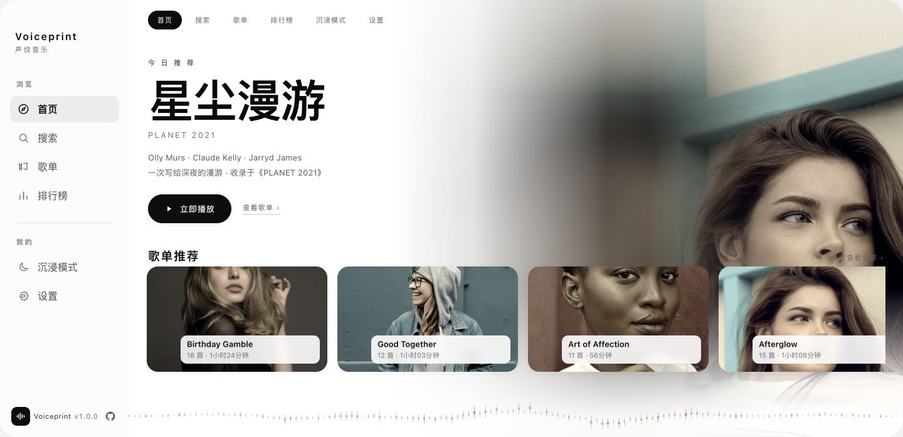

  

<h1 align="center">Voiceprint 声纹音乐</h1>

  
  
  
  

让声音进入你的生活。

  

Voiceprint 是一款 MacBook Pro 音乐播放器的设计稿。听音乐，看歌词，就这样。

这是设计稿，不是能运行的软件：页面是静态 HTML，用来定下界面和动效的样子。

---

## 为什么做这个

听音乐本来是件简单的事。

点开，播放，听。可现在不少音乐软件越做越满，一堆按钮、一堆入口，想听一首歌得先绕过很多东西。

我们想把它做回去：打开就能听，界面上只留下你和音乐。

声纹是这个主意的由来。声音看不见，我们把它画成一串会跳的彩点，跟着节奏起伏。歌词一个字一个字亮起来。你不用懂它怎么做的，听着就行。

让声音进入你的生活，让音乐陪着你，这就是全部。

## 特点

简单明了。

打开就会用，不用学。小学生能上手，不太会用电脑的人也能上手。

界面只有黑白，颜色只出现在声纹和正在播放的时间上。

我们只在三个地方下功夫：音质、动态歌词、音源。剩下的都不重要。

## 为什么做成这样

因为听音乐不该被界面挡住。

打开播放器，你要的是听歌和看歌词。别的都是多余的。所以这里没有复杂的菜单，没有花哨的背景，没有一堆用不上的按钮。留下来的，就是让你听见声音、看见歌词的东西。

简单，是为了让你把注意力放回音乐本身。

## 用了什么，借鉴了什么

- 动态歌词参考了 Folia 的设计思路：歌词是画面的主角，逐字点亮，背景跟着封面颜色变。界面是我们自己设计的，没有用它的代码。
- 音源部分参考了洛雪音乐：音源做成可以导入的音源包，激活后展开它自带的平台，榜单和歌单按平台能力聚合。
- 界面是静态 HTML + CSS，少量 JavaScript 只用来演示动效。

## 产品展示

启动页、首页、播放页：

| 启动页 | 首页 |
| :---: | :---: |
|  |  |

全屏歌词，一个字一个字亮起来：

播放页和全屏歌词：

| 播放页 | 全屏歌词 |
| :---: | :---: |
|  |  |

更多界面在 [`screenshots/`](./screenshots/) 目录：搜索、歌单、发现歌单、电台广场、排行榜、榜单详情、沉浸模式、设置。

## 未来

这套设计接下来会做到：

- 安卓端
- Windows 端
- 车机

## 开源协议

本项目使用 [MIT 协议](./LICENSE)。

动态歌词的设计思路参考了 [Folia](https://github.com/chthollyphile/folia-major)（AGPL-3.0），这里只借鉴视觉与交互方式，没有使用它的代码。音源模式参考了 [洛雪音乐](https://github.com/lyswhut/lx-music-desktop)。

## 状态

- 12 屏设计稿完成，体检和交互验证通过。
- 全站跳转和菜单联动已验证。
- 真实音源、歌词内核、本地存储还未实现。

不注册，不建服务器，数据存在本地。
