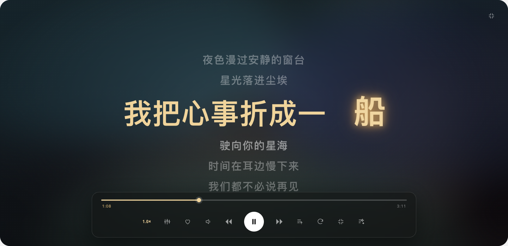

  

<h1 align="center">Voiceprint 声纹音乐</h1>

  
  
  
  
  

把音乐做成看得见的声纹，用最安静的白底衬托出来。

  

本仓库是 MacBook Pro 音乐播放器的**设计稿 / 视觉原型**（12 屏 HTML，1280×800 桌面画幅）：白底极简、以「声纹」为视觉主角，含全屏情景式动态歌词。不是可运行的播放器程序——页面是静态 HTML/CSS/少量演示用 JS，用于确认视觉、动效与交互走向。真实音源、歌词内核、本地存储等属于后续实现阶段，不在本仓库范围内。

---

## 界面预览

启动页 · 首页 · 播放页 · 全屏歌词（点击看大图）：

| 启动页 | 首页 |
| :---: | :---: |
|  |  |

播放页 · 全屏沉浸歌词（核心展示）：

| 播放页 | 全屏歌词 |
| :---: | :---: |
|  |  |

其余界面：搜索 / 歌单 / 发现歌单 / 电台广场 / 排行榜 / 榜单详情 / 沉浸模式 / 设置，截图在 [`screenshots/`](./screenshots/) 目录。

---

## 初衷

做这套设计的起点很简单：看了大量音乐播放器之后，**最喜欢的还是极简白底那种"看着舒服"的感觉**——大留白、细字、克制的控件，靠排版和呼吸感撑起气质，而不是靠渐变、霓虹和花哨装饰。

同时有一个不愿妥协的执念：**动态歌词/声纹应该是主角**。它不是一个塞在角落的装饰，而是把"声音"变成看得见的东西——启动、播放、沉浸三个时刻都有它的存在。

于是定下这条主线：

- **白底极简**：纯白 + 近黑 + 实心黑按钮，拒绝"AI 味"模板感；
- **图片微暖**：封面统一走一层克制的暖调滤镜，让黑白基调里有一点温度；
- **声纹即主角**：低饱和彩点的离子态波形，贯穿启动页、首页与播放页；
- **动态歌词是自研内核的设计位**：借鉴 Folia 的思路（逐字点亮、情景式动态、封面取色背景），但只做设计结构，为将来接数据留好钩子。

一句话：**把音乐做成看得见的声纹，用最安静的白底把它衬托出来。**

---

## 设计语言

| 维度 | 约定 |
| --- | --- |
| 基调 | 纯白底 `oklch(100% 0 0)` + 近黑文字 + 实心黑动作按钮 |
| 图片 | 封面统一滤镜 `grayscale(.46) sepia(.34) saturate(1.06) contrast(1.06)`，微暖不艳 |
| 声纹 | 84 BPM 离子态彩点波形，24% 低饱和彩点（珊瑚红/灰蓝/暖杏），其余冷灰 |
| 圆角 | 窗口 28px（对齐 DSH 主面板），Logo 正方形 30×30 |
| Logo 放置 | 有侧栏的页面放左下角，无侧栏的页面放右上角 |
| 字体 | `-apple-system / SF Pro / PingFang SC`，细体大标题 + 宽字距 |
| 命名 | 产品名 Voiceprint / 声纹音乐；音源一律用谐音意象名（企鹅/拾云/萌狗/暖窝/落屿） |
| 隐私 | 不注册、不建服务器，数据本地存储 |

> 启动页为独立设计：物理掉落 + 弹跳入场动画（logo 果冻弹跳 → 黑块砸破细线碎成离子 → 离子音谱 → 字母掉落 → 中文名），定稿后已冻结。

---

## 页面一览（12 屏）

| 文件 | 页面 | 说明 |
| --- | --- | --- |
| `splash.html` | 启动页 | 物理掉落入场动画 + Enter 拟态扩散进入首页 |
| `home.html` | 首页 | 推荐主视觉 + 大小错落歌单卡 + 双向联动导航 + 底部声纹 |
| `player.html` | 播放页 | 歌词为核心 + 进度条背景声纹 + 播放控制 + 全屏歌词层 / EQ / 样式面板 |
| `search.html` | 搜索 | 即时搜索 + 热词 + 分类浏览 |
| `playlist.html` | 歌单与电台 | 我的歌单 / 发现歌单 / 电台播客 三板块 |
| `discover.html` | 发现歌单 | 满屏网格 + 音源/分类/排序筛选 |
| `radio.html` | 电台广场 | 满屏电台网格 + 分类筛选 + LIVE 标记 |
| `rank.html` | 排行榜 | 按音源聚合的榜单卡 |
| `chart-detail.html` | 榜单详情 | 榜单歌曲列表 + 播放全部/收藏 |
| `immersive.html` | 沉浸模式 | 动态歌词设置：11 种样式 / 5 背景 / 倍速 / 字号 / 实时预览 |
| `settings.html` | 设置 | 音质 / 音源包管理（导入→保存→激活→展开）/ 皮肤 / 关于 |
| `tokens.css` | 设计变量 | 全站共享的颜色、字号、间距、圆角、Logo 组件 |

播放页内含**全屏沉浸歌词层**（封面取色虚化背景 + 逐字点亮 + 浮动播放导航条），是整套设计的核心展示。

所有页面从 `splash.html` 经首页、播放页串联；菜单与顶栏分类双向联动，各页面点播放均跳转播放页。

---

## 关于动态歌词

动态歌词借鉴开源项目 [Folia](https://github.com/chthollyphile/folia-major) 的设计思路（歌词即视觉主体、逐字点亮、情景式动态、封面取色背景），本仓库只做**设计结构与演示动效**，未引入其代码。样式面板中的 11 种歌词样式、5 种背景模式为设计演示级 CSS 动画；真实 WebGL 特效与歌词数据契约留待实现阶段。

音源生态借鉴洛雪音乐（LX Music）的能力模型：音源以「音源包」形式导入、保存、激活，激活后展开其自带平台；榜单/歌单按平台能力动态聚合。

---

## 状态

- ✅ 设计稿 12 屏完成，体检与交互验证通过
- ✅ 全站跳转链自查通过（菜单联动、返回、任意入口点播放→播放页）
- ⏳ 真实音源、歌词内核、本地存储、GitHub 仓库地址、赞助收款码等，均属实现阶段，当前为设计占位
- 📌 本项目不注册、不建服务器，用户数据本地存储

本软件为开源设计项目，具体许可证在实现阶段确定。
